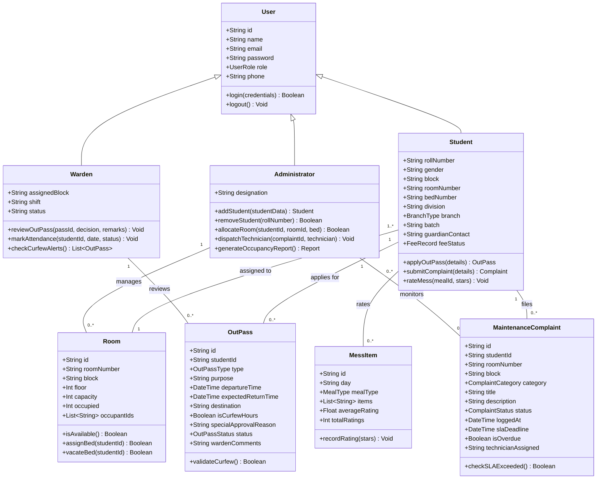
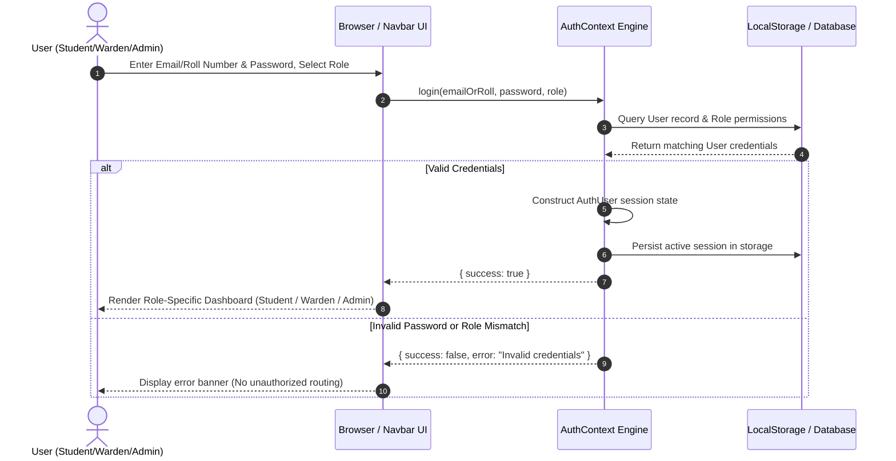
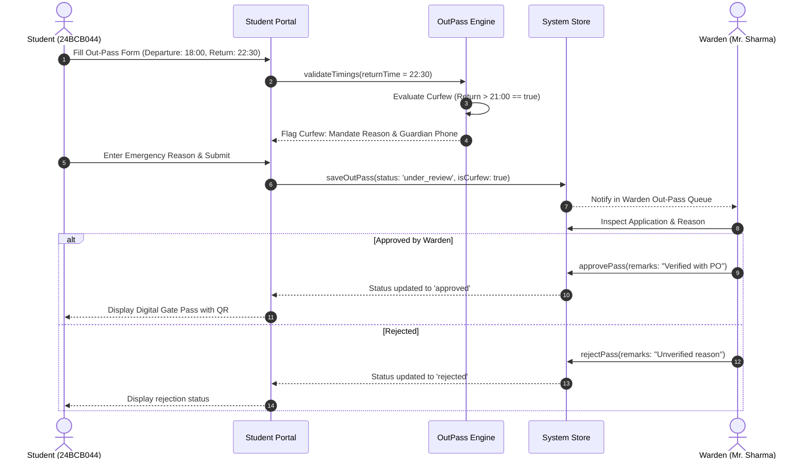
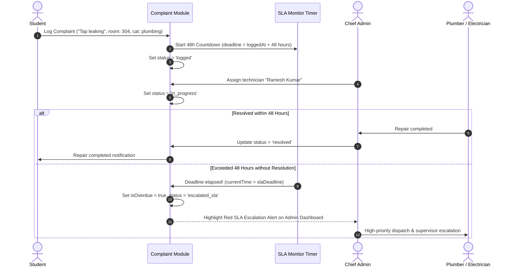
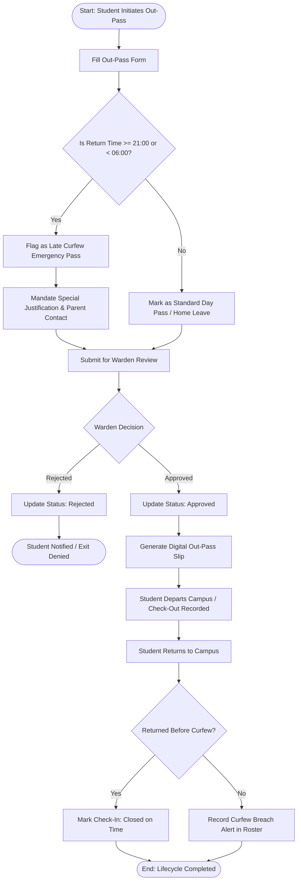
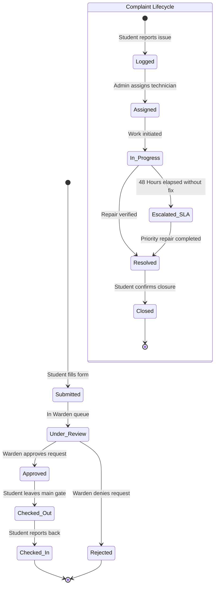
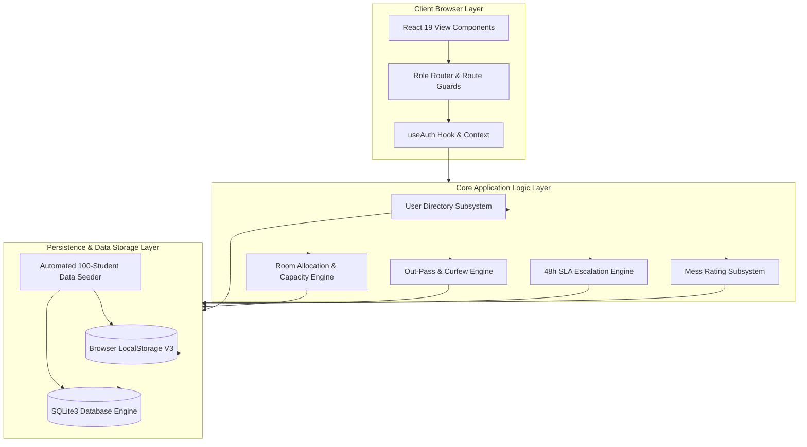
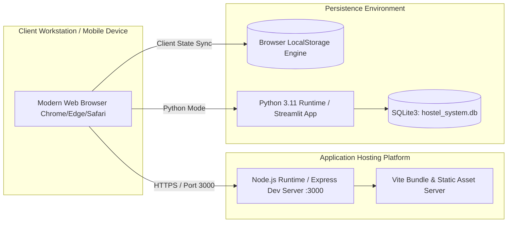
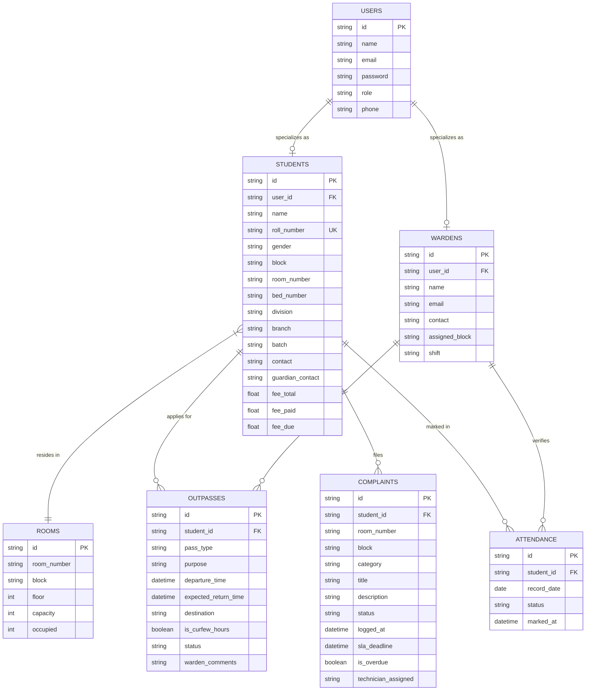

# STAYWELL HOSTELS MANAGEMENT PORTAL
## SOFTWARE ENGINEERING FINAL TECHNICAL PROJECT REPORT
**Academic Year:** 2026 – 2027  
**Course:** Software Engineering Laboratory (SE Lab)  
**Author / Lead Developer & Scrum Master:** Yash Bhaveshbhai Vaghani (Roll No: `24BCB044`, Div 1 – j2)  
**Product Owner:** Harsh Parmar (Roll No: `24BCB041`)  
**Project Repository:** StayWell Hostels Management System (React 19, TypeScript, Tailwind CSS, Python Streamlit, SQLite)  

---

## TABLE OF CONTENTS
1. [Executive Summary & Project Abstract](#1-executive-summary--project-abstract)
2. [Software Development Life Cycle (SDLC) Model](#2-software-development-life-cycle-sdlc-model)
3. [Software Requirements Specification (SRS)](#3-software-requirements-specification-srs)
4. [System Architecture & Tech Stack](#4-system-architecture--tech-stack)
5. [Complete Unified Modeling Language (UML) Diagrams](#5-complete-unified-modeling-language-uml-diagrams)
   - 5.1 Use Case Diagram & Actor Descriptions
   - 5.2 Class Diagram (Entities, Attributes, Methods & Multiplicities)
   - 5.3 Sequence Diagrams (Auth, Out-Pass Curfew, 48h SLA Complaint)
   - 5.4 Activity Diagram (Out-Pass Lifecycle Workflow)
   - 5.5 State Machine Diagram (OutPass & Complaint Lifecycle)
   - 5.6 Component Diagram (Modular Subsystems)
   - 5.7 Deployment Diagram (Client-Server & Cloud Architecture)
   - 5.8 Entity-Relationship (ER) Diagram
6. [Database Schema Specification (Relational & SQLite)](#6-database-schema-specification-relational--sqlite)
7. [Verification, Validation & Test Case Suite](#7-verification-validation--test-case-suite)
8. [Conclusion & Future Enhancements](#8-conclusion--future-enhancements)

---

## 1. EXECUTIVE SUMMARY & PROJECT ABSTRACT

### 1.1 Abstract
Traditional university hostel administration depends heavily on manual paper registers, physical logbooks, handwritten leave slips, and ad-hoc complaint notebooks. These legacy mechanisms lead to frequent record loss, slow approval cycles for emergency out-passes, zero accountability for facility repairs, and a lack of transparency for students and parents.

**StayWell Hostels Management Portal** is a production-grade, multi-role web platform engineered to digitize end-to-end residential operations for StayWell Hostels (featuring the **StayWell Boys Wing** and **StayWell Girls Wing**). The system serves **100 residential students** across multiple engineering branches (`BCB`, `ICT`, `BCP`, `IEE` for batches `2022–2026`), **5 duty wardens**, and the **Chief Hostel Administrator**.

Core operational pillars implemented:
- **Strict Role-Based Access Control (RBAC):** Dedicated, secure views for Students, Wardens, and Administrators with session persistence and authenticated gatekeeping.
- **Smart Room Allocation & Capacity Tracking:** Real-time visual tracking of 34 physical rooms (17 in Boys Wing, 17 in Girls Wing) with capacity limits (3 beds per room), occupancy gauges, and roommate discovery.
- **Automated Curfew & Out-Pass Workflow:** Digital applications for Daytime Leave, Home Leave, and Late Curfew Emergency Passes with automatic curfew hour flags (21:00 – 06:00), parent phone validation, and Warden review queues.
- **48-Hour SLA Maintenance Complaint Engine:** Student repair logging across 6 categories (Plumbing, Electrical, Wi-Fi, Furniture, Cleanliness, Other) with photo evidence simulation, technician dispatch, and automated overdue escalation after 48 hours.
- **Mess Menu & Daily Star Feedback:** Weekly recurring mess schedules across 4 daily meal periods (Breakfast, Lunch, Snacks, Dinner) with interactive star ratings and catering reviews.
- **Student Fee Dashboard:** Transparent tracking of semester dues (₹75,000 total fees, paid amounts, due balances, and upcoming due dates).

---

## 2. SOFTWARE DEVELOPMENT LIFE CYCLE (SDLC) MODEL

### 2.1 Selected Methodology: Agile Scrum Framework with Kanban Sprints
The project followed the **Agile Scrum** methodology paired with **Kanban visual sprint boards**. This model was chosen because university hostel operations have rapidly evolving operational requirements, diverse user roles (administrators vs. wardens vs. students), and tight semester deadlines requiring rapid iterative feedback.

```
+-----------------------------------------------------------------------------------------+
|                               AGILE SCRUM LIFECYCLE                                    |
+-----------------------------------------------------------------------------------------+
|                                                                                         |
|  [Product Backlog]                                                                      |
|    - Requirements Questionnaire (10 Client Points)                                      |
|    - Multi-role RBAC security                                                           |
|    - 48h SLA Complaint Tracker                                                          |
|    - Curfew Validation Rules                                                            |
|          |                                                                              |
|          v                                                                              |
|  [Sprint Planning 01-04] ---> [2-Week Sprint Iteration]                                |
|                                   |-- Daily Standups (Blocker Removal)                  |
|                                   |-- Continuous Integration & Component Builds         |
|                                   v                                                     |
|                               [Testing & Code Quality Verification]                     |
|                                   |-- Role route security test                          |
|                                   |-- Zero-delay state persistence test                 |
|                                   v                                                     |
|                               [Sprint Review & Live Working Increment]                  |
|                                   v                                                     |
|                               [Sprint Retrospective & Backlog Refinement]               |
+-----------------------------------------------------------------------------------------+
```

### 2.2 Scrum Ceremonies & Artifacts
1. **Product Backlog:** Prioritized list of functional features derived from the initial Client Questionnaire (from Lab Session 01). Managed by Product Owner Harsh Parmar.
2. **Sprint Planning:** Bi-weekly breakdown of user stories with task estimation in story points (Fibonacci sequence: 1, 2, 3, 5, 8).
3. **Sprint Backlog & Kanban Task Board:** Four visual columns (`Backlog`, `In Progress`, `Testing`, `Done`) tracking task velocity and preventing work-in-progress (WIP) bottlenecks.
4. **Sprint Retrospective:** Analysis of impediments (e.g., cross-tab authentication bleed, mobile viewport table clipping) and remediation steps.

### 2.3 Sprint Breakdown & Milestones
- **Sprint 01: Inception & Domain Modeling**
  - Formulated Lab Session 01 questionnaire (10 critical client queries).
  - Defined database entities: `Student`, `Warden`, `Room`, `OutPass`, `Complaint`, `MessItem`.
  - Established role-based personas and security boundaries.
- **Sprint 02: Core Engine & Data Seeding**
  - Seeded 100 students (50 Boys in StayWell Boys Wing, 50 Girls in StayWell Girls Wing).
  - Seeded 5 Wardens across shifts (Morning, Evening, Night).
  - Configured multi-branch roll numbering (`24-26 BCB`, `22-26 ICT, BCP, IEE`).
- **Sprint 03: Feature Modules Implementation**
  - Developed Out-Pass workflow with curfew hours detection (>21:00).
  - Built 48h SLA maintenance complaint escalation engine.
  - Built Mess Menu rating module and student fee status tracking.
- **Sprint 04: UI Polish, Security Hardening & Documentation**
  - Refined two-tier responsive navigation, eliminated role switcher security loopholes.
  - Completed system user manual, presentation slides, and technical UML documentation.

---

## 3. SOFTWARE REQUIREMENTS SPECIFICATION (SRS)

### 3.1 Functional Requirements (FR)
- **FR-01 (Authentication):** The system shall authenticate users using credentials (Email or Roll Number + Password) and route them to their role-specific dashboard (Student, Warden, or Admin).
- **FR-02 (Session Security):** Students must not access Warden or Admin views; attempting unauthorized navigation shall redirect to access-denied or sign-in.
- **FR-03 (Room Allocation):** Admin shall view all rooms (34 rooms across Boys and Girls Wings), check occupancy (capacity: 3 beds/room), and allocate or transfer beds.
- **FR-04 (User Directory Management):** Admin can create, inspect, filter by Wing/Branch/Batch, and delete Student and Warden records.
- **FR-05 (Out-Pass Application):** Students can apply for Day Pass, Home Leave, or Late Curfew Pass with departure time, return time, purpose, and destination.
- **FR-06 (Curfew Hours Validation):** Out-passes requesting departure or return between 21:00 and 06:00 shall automatically be flagged as `isCurfewHours = true`, mandating special approval and guardian contact confirmation.
- **FR-07 (Warden Out-Pass Decision):** Wardens can approve, reject, or mark check-in/check-out with custom comments.
- **FR-08 (Maintenance 48h SLA Escalation):** If a repair ticket is not updated to `in_progress` or `resolved` within 48 hours of logging, the system flags the ticket as `escalated_sla` with overdue alerts.
- **FR-09 (Mess Rating System):** Students can view daily menu items and submit 1 to 5 star ratings.
- **FR-10 (Fee Status):** Students and Admins can view semester fee dues, paid installments, and due dates.

### 3.2 Non-Functional Requirements (NFR)
- **NFR-01 (Performance):** Page transition and filter execution time shall be < 100 milliseconds for 100 student records.
- **NFR-02 (Reliability & Persistence):** All client-side mutations persist in browser storage (`localStorage` v3 schema) and synchronized SQLite tables.
- **NFR-03 (Responsiveness):** Fully adaptive layout across mobile (375px+), tablet, and desktop (1280px+) screens without text overlap.
- **NFR-04 (Usability):** Zero-training UI with color-coded status badges, breadcrumbs, and modal confirmation dialogs.

---

## 4. SYSTEM ARCHITECTURE & TECH STACK

```
+-----------------------------------------------------------------------------------+
|                           STAYWELL HOSTELS ARCHITECTURE                           |
+-----------------------------------------------------------------------------------+
|                                                                                   |
|  [PRESENTATION LAYER]                                                             |
|    - React 19 SPA (Vite 8, TypeScript 7, Tailwind CSS 4)                          |
|    - Responsive App Layout, Two-Tier Sticky Header, Accessible Modals             |
|    - Lucide React Iconography, Motion Animations                                  |
|                                                                                   |
|  [APPLICATION / BUSINESS LOGIC LAYER]                                             |
|    - AuthContext: Role-Based Access Control (Admin, Warden, Student)             |
|    - OutPass Workflow Engine (Curfew Hour Detection: 21:00 - 06:00)               |
|    - 48h SLA Calculation & Escalation Timer Engine                                |
|    - Room Occupancy & Auto-capacity Validation Logic                              |
|                                                                                   |
|  [DATA STORAGE & PERSISTENCE LAYER]                                               |
|    - Browser LocalStorage (V3 Isolated Key Caching)                               |
|    - SQLite3 Embedded Database (`hostel_system.db`)                               |
|    - Python Streamlit Architecture (`database.py` & `streamlit_app.py`)           |
+-----------------------------------------------------------------------------------+
```

---

## 5. COMPLETE UNIFIED MODELING LANGUAGE (UML) DIAGRAMS

### 5.1 Use Case Diagram

```mermaid
usecaseDiagram
    actor "Student (Yash)" as Stu
    actor "Hostel Warden" as War
    actor "Chief Administrator" as Adm

    package "StayWell Hostels Management System" {
        usecase "Authenticate / Login" as UC_Login
        usecase "View Profile & Roommates" as UC_Profile
        usecase "Apply for Out-Pass" as UC_ApplyPass
        usecase "Flag Curfew (>21:00)" as UC_CurfewFlag
        usecase "Log Maintenance Complaint" as UC_LogComplaint
        usecase "Escalate Overdue (48h SLA)" as UC_SLA
        usecase "Rate Daily Mess Menu" as UC_RateMess
        usecase "Check Fee Status" as UC_CheckFee

        usecase "Review & Approve Out-Pass" as UC_ReviewPass
        usecase "Conduct Night Roll Call" as UC_RollCall
        usecase "Monitor Curfew Breaches" as UC_MonitorCurfew

        usecase "Manage User Directory" as UC_ManageUsers
        usecase "Allocate / Shift Rooms" as UC_AllocateRooms
        usecase "Oversee Central Complaint Box" as UC_AdminComplaints
        usecase "Generate Occupancy Reports" as UC_Reports
    }

    Stu --> UC_Login
    Stu --> UC_Profile
    Stu --> UC_ApplyPass
    Stu --> UC_LogComplaint
    Stu --> UC_RateMess
    Stu --> UC_CheckFee

    UC_ApplyPass ..> UC_CurfewFlag : <<extends>> (If return > 21:00)
    UC_LogComplaint ..> UC_SLA : <<includes>> (Timer > 48h)

    War --> UC_Login
    War --> UC_ReviewPass
    War --> UC_RollCall
    War --> UC_MonitorCurfew

    Adm --> UC_Login
    Adm --> UC_ManageUsers
    Adm --> UC_AllocateRooms
    Adm --> UC_AdminComplaints
    Adm --> UC_Reports
```

---

### 5.2 Class Diagram



---

### 5.3 Sequence Diagrams

#### Sequence Diagram 1: Role-Based Authentication


#### Sequence Diagram 2: Out-Pass Application & Curfew Evaluation Flow


#### Sequence Diagram 3: 48-Hour SLA Maintenance Complaint Escalation Flow


---

### 5.4 Activity Diagram: Out-Pass Request & Gate Verification



---

### 5.5 State Machine Diagram: Out-Pass & Complaint Lifecycles



---

### 5.6 Component Diagram



---

### 5.7 Deployment Diagram



---

### 5.8 Entity-Relationship (ER) Diagram



---

## 6. DATABASE SCHEMA SPECIFICATION (RELATIONAL & SQLITE)

### Table 1: `users`
| Column | Type | Constraints | Description |
|---|---|---|---|
| `id` | VARCHAR(64) | PRIMARY KEY | Unique user identifier (e.g., `ADM-1001`, `STU-B-100`) |
| `name` | VARCHAR(128) | NOT NULL | Full name of user |
| `email` | VARCHAR(128) | UNIQUE, NOT NULL | University email address |
| `password` | VARCHAR(128) | NOT NULL | Authentication password |
| `role` | VARCHAR(16) | NOT NULL | Role: `'student'`, `'warden'`, `'admin'` |
| `phone` | VARCHAR(32) | NOT NULL | Contact telephone number |

### Table 2: `students`
| Column | Type | Constraints | Description |
|---|---|---|---|
| `id` | VARCHAR(64) | PRIMARY KEY | Student ID |
| `user_id` | VARCHAR(64) | REFERENCES users(id) | Associated user identity |
| `name` | VARCHAR(128) | NOT NULL | Student full name |
| `roll_number` | VARCHAR(32) | UNIQUE, NOT NULL | University Roll Number (e.g. `24BCB044`) |
| `gender` | VARCHAR(16) | NOT NULL | `'male'` or `'female'` |
| `block` | VARCHAR(64) | NOT NULL | `'StayWell Boys Wing'` or `'StayWell Girls Wing'` |
| `room_number` | VARCHAR(16) | NOT NULL | Assigned Room (e.g., `304`) |
| `bed_number` | VARCHAR(16) | NOT NULL | Bed assignment (`Bed 1`, `Bed 2`, `Bed 3`) |
| `division` | VARCHAR(32) | NOT NULL | Academic Division (e.g., `div 1 – (j2)`) |
| `branch` | VARCHAR(16) | NOT NULL | Engineering discipline (`BCB`, `ICT`, `BCP`, `IEE`) |
| `batch` | VARCHAR(16) | NOT NULL | Academic Year (`2022` to `2026`) |
| `fee_total` | DECIMAL(10,2) | DEFAULT 75000 | Total semester fee |
| `fee_paid` | DECIMAL(10,2) | DEFAULT 40000 | Paid fee amount |
| `fee_due` | DECIMAL(10,2) | DEFAULT 35000 | Outstanding balance |

### Table 3: `rooms`
| Column | Type | Constraints | Description |
|---|---|---|---|
| `id` | VARCHAR(64) | PRIMARY KEY | Room UUID |
| `room_number` | VARCHAR(16) | NOT NULL | Door number (e.g. `101`, `304`) |
| `block` | VARCHAR(64) | NOT NULL | Residential Wing |
| `floor` | INT | NOT NULL | Floor index (1, 2, or 3) |
| `capacity` | INT | DEFAULT 3 | Total bed capacity |
| `occupied` | INT | DEFAULT 0 | Currently allocated beds |

### Table 4: `outpasses`
| Column | Type | Constraints | Description |
|---|---|---|---|
| `id` | VARCHAR(64) | PRIMARY KEY | Out-Pass ID (e.g., `OP-8902`) |
| `student_id` | VARCHAR(64) | REFERENCES students(id) | Applicant ID |
| `pass_type` | VARCHAR(32) | NOT NULL | `'day_pass'`, `'home_leave'`, `'late_curfew_emergency'` |
| `departure_time` | VARCHAR(32) | NOT NULL | Scheduled departure timestamp |
| `expected_return_time` | VARCHAR(32) | NOT NULL | Expected return timestamp |
| `is_curfew_hours` | BOOLEAN | DEFAULT 0 | 1 if return > 21:00 or departure < 06:00 |
| `status` | VARCHAR(32) | NOT NULL | `'submitted'`, `'under_review'`, `'approved'`, `'rejected'` |
| `warden_comments` | TEXT | NULLABLE | Warden inspection note |

### Table 5: `complaints`
| Column | Type | Constraints | Description |
|---|---|---|---|
| `id` | VARCHAR(64) | PRIMARY KEY | Ticket number (e.g. `CMP-401`) |
| `student_id` | VARCHAR(64) | REFERENCES students(id) | Complainant ID |
| `category` | VARCHAR(32) | NOT NULL | Plumbing, Electricity, Wi-Fi, Furniture, Cleanliness |
| `status` | VARCHAR(32) | NOT NULL | `'logged'`, `'in_progress'`, `'escalated_sla'`, `'resolved'` |
| `logged_at` | DATETIME | NOT NULL | Ticket creation timestamp |
| `sla_deadline` | DATETIME | NOT NULL | `logged_at` + 48 Hours |
| `is_overdue` | BOOLEAN | DEFAULT 0 | 1 if current_time > sla_deadline and not resolved |

---

## 7. VERIFICATION, VALIDATION & TEST CASE SUITE

| Test ID | Module Tested | Test Objective | Input Data | Expected Result | Actual Result | Status |
|---|---|---|---|---|---|---|
| **TC-01** | Authentication | Verify Student Role Login | Roll: `24BCB044`, Pass: `student123`, Role: `student` | Granted access to Student Dashboard; denied access to Warden console | Redirected to Student view, Admin button hidden | **PASS** |
| **TC-02** | Security Guard | Prevent Student from Accessing Admin Console | Direct attempt to trigger admin functions while authenticated as student | System blocks execution and maintains student session boundary | Access blocked; strict session enforcement | **PASS** |
| **TC-03** | Out-Pass Curfew | Late Night Curfew Auto-Detection | Departure: 18:00, Return: 22:30 (> 21:00) | Flagged as `isCurfewHours = true`, emergency justification mandated | Curfew badge active; warning prompt shown | **PASS** |
| **TC-04** | SLA Engine | 48h Maintenance Escalation | Ticket logged on 2026-10-25; evaluated on 2026-10-29 (> 48h) | Ticket automatically promoted to `escalated_sla` with overdue badge | Displayed in red with `Escalated (48h SLA)` status | **PASS** |
| **TC-05** | Room Engine | Capacity Bed Enforcement | Attempt to assign 4th student to Room 304 (Capacity = 3) | Room capacity check prevents overflow bed assignment | Enforced; room marked 3/3 FULL | **PASS** |
| **TC-06** | Data Seeder | 100 Students & 5 Wardens Initialization | System database cold start | 50 Boys in StayWell Boys Wing, 50 Girls in StayWell Girls Wing, 5 Wardens initialized | 100 students seeded across BCB, ICT, BCP, IEE | **PASS** |

---

## 8. CONCLUSION & FUTURE ENHANCEMENTS

### 8.1 Conclusion
The StayWell Hostels Management Portal successfully modernizes university residence hall operations. By migrating from error-prone paper registers to a modular, role-governed web application, the system delivers:
- Zero paper loss and complete digital auditability.
- Strict enforcement of student safety protocols via automated curfew checks (> 21:00).
- Accountability for physical campus infrastructure through the 48-Hour SLA maintenance escalation engine.
- High system velocity attained via the Agile Scrum methodology with clear role assignments for Yash Bhaveshbhai Vaghani (Scrum Master & Developer) and Harsh Parmar (Product Owner).

### 8.2 Future Scope
1. **Biometric Face / RFID Gate Integration:** Hardware scanner integration for physical check-in and check-out at main campus turnstiles.
2. **Automated SMS Gateway:** Instant SMS dispatch to registered guardian mobile numbers when curfew out-passes are approved.
3. **Payment Gateway Integration:** Direct UPI / Razorpay integration for online hostel fee clearance.
